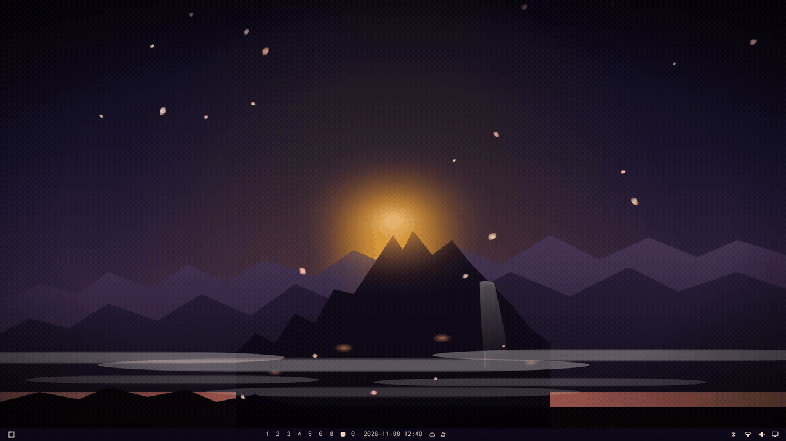

# Flower-Fruit Mountain (Omarchy Theme)

A dark, atmospheric theme inspired by the legendary Flower-Fruit Mountain (*Huāguǒ Shān*) and the visual identity of [MonkeyKing.dev](https://monkeyking.dev). Features animated blossom petals blown by random wind, deep obsidian backgrounds, vibrant amber and peach blossom accents, high-contrast typography, and custom desktop artwork.



Animated blossom petals drift across the desktop, blown by random wind, alongside a pulsing summit glow and an animated waterfall. The live preview above showcases the animation and wallpaper cycling. Install both the theme and the live plugin below to enable the animation.

## Palette Highlights

- **Background**: Deep Obsidian (`#0d0a1a`, `#050308`, `#020203`)
- **Accent**: Sunburst Amber (`#f5a524`)
- **Highlights**: Dawn Peach (`#f4a48a`) and Golden Staff (`#f8d28a`)
- **Foreground**: Natural Rice Ink (`#e7e5dd`) with 15.5:1 WCAG contrast ratio

## Installation

Install the theme and live animation using the official [Omarchy](https://omarchy.org) commands below. Review and confirm the plugin trust prompt when asked:

```bash
omarchy theme install https://github.com/monkeyking-hq/omarchy-flower-fruit-mountain-theme.git && omarchy plugin add https://github.com/monkeyking-hq/omarchy-flower-fruit-mountain-theme.git --enable
```

Omarchy will clone and activate the theme, then install and enable its live animation plugin.

### Live animation

If the theme is already installed without its live animation plugin, install and enable the plugin separately:

```bash
omarchy plugin add https://github.com/monkeyking-hq/omarchy-flower-fruit-mountain-theme.git --enable
```

The plugin requires Omarchy's Quickshell-based shell with native plugin support, the `QtQuick.Particles` and `QtQuick.Shapes` QML modules, and Omarchy's `qs.Ui.ScreenMoveRemap` component. Validated on Omarchy 4.5.0-3. Omarchy installations missing these components, including desktops running Waybar without the Omarchy shell, cannot run this overlay.

The overlay follows the resolved wallpaper path at `~/.local/state/omarchy/current/background`. It appears only when that path contains `flower-fruit-mountain`, and hides when you switch to another wallpaper path. It creates an overlay for each monitor, shares the random wind across screens, and scales the scene to match the wallpaper's crop. The summit glow and waterfall are positioned for the Flower-Fruit Mountain artwork.

Control the animation independently of the palette:

```bash
omarchy plugin disable flower-fruit-mountain
omarchy plugin enable flower-fruit-mountain
```

Update the installed plugin from this repository:

```bash
omarchy plugin update flower-fruit-mountain
```

Updates require a Git-managed installation that can fast-forward; local edits or a diverged checkout can prevent an update. The command shows the changes and asks for confirmation before applying them.

## Applying the Theme Manually

If already installed, switch to this theme anytime via:

```bash
omarchy theme set flower-fruit-mountain
```

Or open the interactive theme switcher:

```bash
omarchy theme switcher
```

## Cycling Backgrounds

This theme includes custom backgrounds in 4K resolution:
1. Flower-Fruit Mountain at Dawn
2. Dawn Ridges
3. Peach Blossom Grove
4. The Golden Staff
5. The Circlet

Cycle to the next background:
```bash
omarchy theme bg next
```
Or open the background switcher:
```bash
omarchy theme bg-switcher
```

## Universal Code

This project follows the [Universal Code v1.0.0](https://github.com/monkeyking-hq/universal-code).

## License

Released under the [MIT License](LICENSE).
